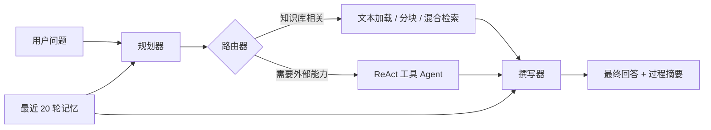

# Multi-Agent Knowledge Assistant

[中文](README.md) · [English](README.en.md) · [演示说明](docs/demo.md) · [验证记录](docs/verification.md)

一个面向个人知识库场景的 Python 助手：它先规划问题，再在 RAG 与 ReAct 工具 Agent 之间路由，最后整合回答。项目重点不是堆叠 Agent 数量，而是把知识检索、工具调用、多轮记忆和可观察的执行过程串成一条可运行链路。

## 核心能力

- **规划—执行—撰写工作流**：规划器判断任务类型，执行器选择知识库或工具，撰写器整合结果。
- **RAG / Agent 动态路由**：关键词优先，随后使用 BM25 与向量相似度混合分数，模糊区间由 LLM 复核。
- **知识库问答**：加载本地 `.txt` 文档、分块、向量检索，并限制回答基于检索上下文。
- **多轮记忆**：保存最近 20 轮会话，并为追问注入最近上下文。
- **ReAct 工具集**：天气、时间、安全算术、网络搜索、日历、笔记和可选邮件工具。
- **双界面**：Gradio 为主入口，Streamlit 为备选入口；支持上传文本并重建索引。

## 工作流



路由采用三段式决策：显式知识库关键词 → BM25/向量混合检索 → LLM 复核。当前 BM25 权重为 `0.6`，向量权重为 `0.4`，综合阈值为 `0.35`。

## 快速启动

要求 Python 3.11。首次运行会下载默认中文向量模型；也可通过 `EMBEDDING_MODEL` 指向本地模型目录。

```bash
python -m venv .venv
# Windows: .venv\Scripts\activate
# macOS/Linux: source .venv/bin/activate
pip install -r requirements.txt
cp .env.example .env  # Windows 可使用 copy .env.example .env
```

编辑 `.env`，至少填写 `ZHIPU_API_KEY`，然后启动：

```bash
python app.py
```

浏览器访问 `http://127.0.0.1:7861`。Streamlit 入口为：

```bash
streamlit run app_st.py
```

Docker 方式：

```bash
docker build -t multi-agent-knowledge-assistant .
docker run --rm -p 7861:7861 --env-file .env multi-agent-knowledge-assistant
```

## 项目结构

```text
.
├── app.py                 # Gradio 主界面
├── app_st.py              # Streamlit 备选界面
├── src/
│   ├── multi_agent.py     # 规划、执行、撰写与记忆
│   ├── router.py          # RAG / Agent 混合路由
│   ├── rag_engine.py      # 文档加载、向量库与检索链
│   ├── agent_manager.py   # LangGraph ReAct Agent
│   ├── tools.py           # 工具实现
│   └── config.py          # 环境配置
├── knowledge_base/        # 合成演示文档
├── tests/                 # 离线安全与结构测试
└── docs/                  # 设计、演示、验证与路线说明
```

## 验证

```bash
python -m compileall -q src app.py app_st.py
pytest
ruff check src tests
```

不需要 API Key 的离线测试覆盖源码语法、算术表达式安全和笔记路径隔离。GitHub Actions 会在每次推送和 Pull Request 中重复执行语法、测试与仓库敏感内容审计。完整 RAG/Agent 端到端运行需要模型与外部 API，验证范围及结果见 [docs/verification.md](docs/verification.md)。

## 项目边界

- 当前会话记忆保存在进程内，重启后不会保留，也没有用户隔离。
- 默认检索语料仅支持 `.txt`；上传文件会触发同步重建，适合小型演示知识库。
- 天气与搜索依赖公开网络服务；邮件工具只有显式配置 SMTP 后才启用。
- 当前路由阈值来自小规模人工调试，尚未建立标准化评测集。
- 界面中的“过程摘要”用于展示路由与工具轨迹，不等同于模型私有推理过程。

## 开发说明与归属

该项目由仓库作者负责需求规划、工作流设计、任务拆解、代码检查、问题修复与验收，并在实现过程中使用 AI 编程工具协作。公开版本基于作者原有项目整理，未包含原目录中的密钥、本地模型、个人数据、缓存或运行日志。

主要框架及其许可证由各上游项目维护，包括 LangChain、LangGraph、Gradio、Streamlit、Chroma 与 Sentence Transformers；本仓库不重新分发默认向量模型权重。详情见 [THIRD_PARTY_NOTICES.md](THIRD_PARTY_NOTICES.md)。

## License

项目代码采用 [MIT License](LICENSE)。
